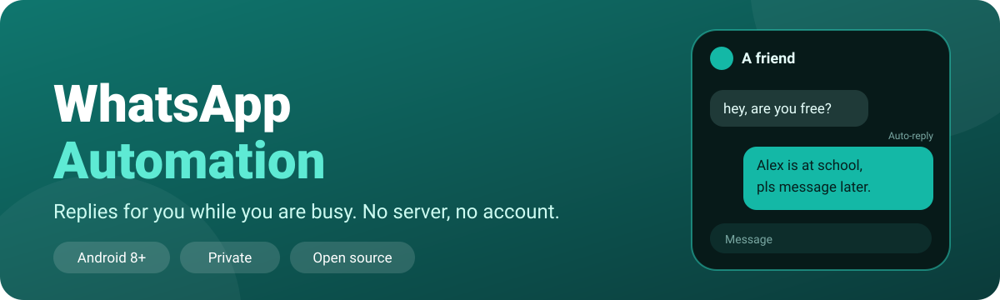
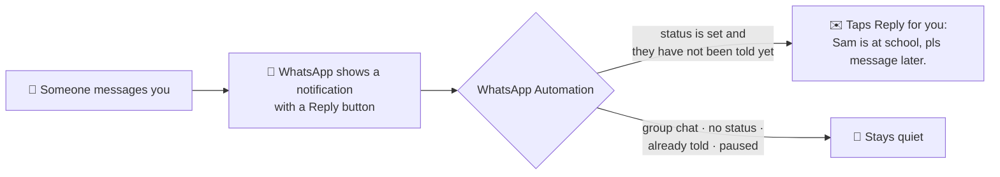

<p align="center">
  
</p>

<p align="center">
  <a href="https://github.com/heyitsaadin/whatsapp-automation/releases/latest"></a>
  <a href="https://github.com/heyitsaadin/whatsapp-automation/actions/workflows/ci.yml"></a>
  
  <a href="LICENSE"></a>
</p>

<p align="center">
  <a href="https://github.com/heyitsaadin/whatsapp-automation/releases/latest"><b>⬇️ Download the latest APK</b></a>
</p>

---

## ✨ What it does

Set what you're doing, switch it on, and anyone who messages you on WhatsApp gets a short note from you. You don't touch your phone.

> 👤 **Amma:** hey, are you free?  
> 🤖 **You (automatic):** Sam is at school, pls message later.

|  |  |
|---|---|
| 🔒 **Private** | Everything stays on your phone. No account, no server, no analytics. |
| 💬 **WhatsApp never opens** | The app taps the **Reply** button on the notification for you. |
| 🌙 **Works with the screen off** | A light background service keeps it awake. |
| 🎯 **One note per person** | Again only if your status changes, or after 30 minutes. |
| 📍 **Status with a place** | "Travelling to Goa": type it, search it, or tap **Use my location**. |
| ⏯️ **One-tap pause** | **Start** and **Stop** on the main card. |

## 🧭 How it works



## 🚀 Install in 2 minutes

**1. Download** the APK from the [latest release](https://github.com/heyitsaadin/whatsapp-automation/releases/latest) and open it. Allow "install unknown apps" if Android asks.

**2. Grant access.** Open **WhatsApp Automation** and tap the button on each row:

| Row | Needed? | Why |
|---|---|---|
| **Notification access** | ✅ Required | This is how it sees your messages. |
| **Run in background** | ✅ Required | So replies still go out with the screen off. |
| **Show notification** | Optional | Shows an "auto-reply is on" notice while it runs. |

**3. Set your status.** Tap **Set status**, pick one, add a place and your name if you like, then **Save**.

**4. Check the top card.** It should say **Auto-reply is on**. Done. 🎉

> **Android 13 or newer, and Notification access is greyed out?**  
> Settings → Apps → WhatsApp Automation → ⋮ (three dots) → **Allow restricted settings**. Then try again.

## 🎛️ Set your status

| You can... | How |
|---|---|
| **Pick a quick status** | Tap one of the chips. |
| **Write your own** | Type it. Your own words win over a chip. |
| **Add a place** | Type to search, tap a recent place, or tap **Use my location**. "Travelling" + "Goa" becomes "Travelling to Goa". |
| **Use your name** | The reply says "Sam is at school...". Leave it empty and it says "I'm at school...". |
| **Turn replies off** | **Clear status**, or **Stop** on the main card. |

## 🧩 Make it yours

You don't need a computer, only a GitHub account.

1. Tap **Fork** at the top of this page.
2. In your fork open **Actions** and enable workflows.
3. **Actions → CI → Run workflow.** After about two minutes the test APK is at the bottom of the run.

Easy things to change (edit the file on GitHub, commit, wait for the build):

| What | Where |
|---|---|
| App icon | `android-keyboard/app/src/main/res/drawable-nodpi/ic_launcher_image.png` (square PNG, 432 px, keep the logo in the middle 60%) |
| Wording of the reply | the `Info` class in `Status.java` |
| Quick status chips | `android-keyboard/app/src/main/res/layout/dialog_tag.xml` |
| App name | `app_name` in `android-keyboard/app/src/main/res/values/strings.xml` |
| App id (to install next to the original) | `applicationId` in `android-keyboard/app/build.gradle` |
| A toast for every skipped message | `DEBUG = true` in `ReplyListener.java` |

## 📦 Releasing

For whoever publishes the APK (you, if you forked).

**Publish a release**

- **Actions → Release → Run workflow**, type a version like `1.0.0`. The workflow builds the APK, creates the tag `v1.0.0` and attaches `WhatsApp-Automation-v1.0.0.apk` with its checksum.
- Or push a tag: `git tag v1.0.0 && git push origin v1.0.0`.
- A version with a dash, like `1.1.0-beta`, is published as a pre-release.

**One-time setup: your private signing key**

Android only installs an update if it is signed with the same key as the app already on the phone, so keep one key forever. Without the secrets below the workflow still works, but signs with a public key that anyone could copy, so don't hand that APK to other people.

```bash
# on any computer (or Termux) with a JDK
keytool -genkeypair -v -keystore release.jks -alias whatsapp-automation \
  -keyalg RSA -keysize 4096 -validity 36500
base64 -w0 release.jks        # copy this long text
```

Then in the repo: **Settings → Secrets and variables → Actions → New repository secret**, and add:

| Secret | Value |
|---|---|
| `KEYSTORE_BASE64` | the long text from `base64` |
| `KEYSTORE_PASSWORD` | the keystore password you typed |
| `KEY_ALIAS` | `whatsapp-automation` |
| `KEY_PASSWORD` | the key password you typed |

> ⚠️ **Back up `release.jks` somewhere safe** (not in the repo). If you lose it you can never ship an update that installs over the old one.

## 🔒 Privacy

- Your status, name and recent places are saved only on your phone.
- No accounts, analytics or ads.
- The only internet use is **place search**. Text you type in the Place box (or your rough coordinates, if you tap **Use my location**) goes to the free [Photon](https://photon.komoot.io) service, built on OpenStreetMap, to find place names. It is optional.
- Location permission is only asked when you tap **Use my location**, and only coarse (town level).
- Message text is read on your phone to answer it and is never stored or sent anywhere.

## ⚠️ Good to know

- Works with **WhatsApp** (`com.whatsapp`), not WhatsApp Business.
- It can only answer messages that raise a notification with a Reply button. Muted chats, and a chat that is open on screen, don't.
- Only one-to-one chats get a reply. Group chats are skipped.
- WhatsApp can change how its notifications work and break this.
- It sends real messages as you, with nobody checking. Try it with a friend first.
- Automating WhatsApp may go against its terms of service. Use it on your own account, at your own risk.

## 🛠️ Troubleshooting

<details>
<summary><b>Nobody gets a reply</b></summary>

The top card must say **Auto-reply is on**, a status must be set, and **Notification access** must be on.
</details>

<details>
<summary><b>Notification access is greyed out</b></summary>

Android 13 or newer: Settings → Apps → WhatsApp Automation → ⋮ → **Allow restricted settings**.
</details>

<details>
<summary><b>Works with the screen on, but not with it off</b></summary>

Set **Run in background** to unrestricted. Some phone makers (Xiaomi, Oppo, Vivo, Samsung and others) add their own battery savers that kill background apps: turn off battery optimisation for this app there too, and lock it in the recent apps list.
</details>

<details>
<summary><b>It replied once and never again to the same person</b></summary>

That is on purpose: one note per person per 30 minutes, unless your status changes.
</details>

<details>
<summary><b>"Use my location" finds nothing</b></summary>

Turn on location in quick settings and try again, or just type the place.
</details>

<details>
<summary><b>Installing says the app conflicts with an existing one</b></summary>

The old copy was signed with a different key. Uninstall it once, then install again.
</details>

## 📁 What's in this repo

```
android-keyboard/   the Android app (Java, Material 3)
.github/workflows/  CI (test build on every push) and Release (publishes the APK)
assets/             the banner above
```

The app folder is still called `android-keyboard` because the very first version was a keyboard.

## 📄 License

[MIT](LICENSE). WhatsApp is a trademark of WhatsApp LLC. This is an independent open-source project and is not affiliated with, or endorsed by, WhatsApp or Meta.
